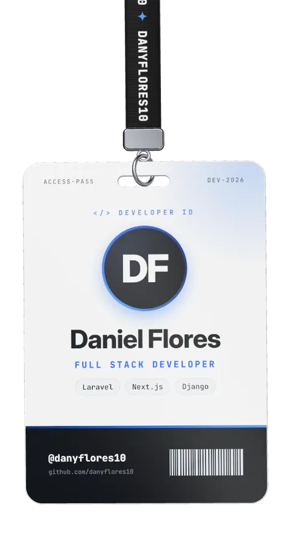

<!-- ═══════════════════════════════ HEADER ═══════════════════════════════ -->

 
<!-- ID CARD (lanyard 3D renderizado con React Bits + Three.js) -->

  

 

<!-- ═══════════════════════════════ TECH STACK ═══════════════════════════════ -->

 

<table>
  <tr>
    <td align="center" width="50%">
       
      
        
      
        
    </td>
    <td align="center" width="50%">
       
      
        
      
        
    </td>
  </tr>
  <tr>
    <td align="center" width="50%">
       
      
        
      
        
    </td>
    <td align="center" width="50%">
       
      
        
      
        
    </td>
  </tr>
</table>

 

<!-- ═══════════════════════════════ GITHUB ANALYTICS ═══════════════════════════════ -->

 

  

 

<!-- ═══════════════════════════════ CONNECT ═══════════════════════════════ -->

 

 

<!-- ═══════════════════════════════ SNAKE ═══════════════════════════════ -->

  <picture>
    <source media="(prefers-color-scheme: dark)" srcset="https://raw.githubusercontent.com/danyflores10/danyflores10/output/github-snake-dark.svg?v=2"/>
    <source media="(prefers-color-scheme: light)" srcset="https://raw.githubusercontent.com/danyflores10/danyflores10/output/github-snake.svg?v=2"/>
    
  </picture>

 

<!-- ═══════════════════════════════ FOOTER ═══════════════════════════════ -->

  Designed &amp; built by <b>Daniel Flores</b> &nbsp;·&nbsp; 2026

